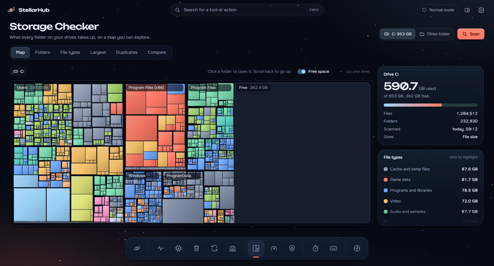
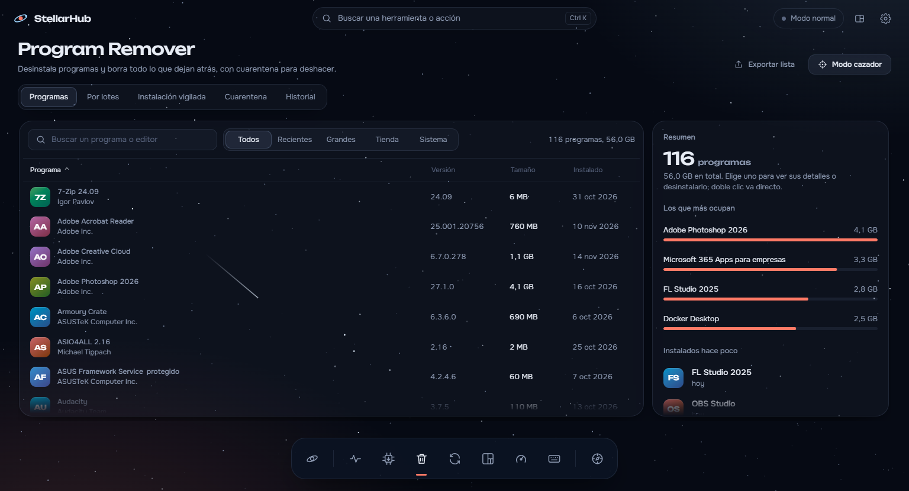

<div align="center">

# 🪐 StellarHub

**The control center for your Windows PC.**
Live hardware stats, drivers, apps, disk space, cleanup and hardware tests, in one carefully crafted app.

[](LICENSE)


[](https://github.com/estebanarosemena/StellarHub/releases/latest)


</div>

## 📑 Contents

- [What it is](#-what-it-is)
- [Modules](#-modules)
- [Also included](#-also-included)
- [Screenshots](#-screenshots)
- [Getting started](#-getting-started)
- [Keyboard shortcuts](#-keyboard-shortcuts)
- [Safety](#-safety)
- [How it's built](#-how-its-built)
- [Roadmap](#-roadmap)
- [Contributing](#-contributing)
- [License and credits](#-license-and-credits)

## ✨ What it is

StellarHub brings together the tools that are usually spread across half a dozen programs: a system monitor,
a driver and app updater, an uninstaller that removes leftovers, a disk space analyzer, an optimizer and a
peripheral tester.

Everything works with **real data from your PC**, everything that changes the system is **reversible** whenever
possible, and the interface is designed to be a pleasure to use: smooth animations, a configurable starfield and
no cluttered screens.

## 🧩 Modules

### ⌂ Home
Your PC at a glance: the real model, its components as a **tile grid** or a **3D model** you can rotate, live
stats (CPU, GPU, temperatures, memory, disk, network, battery), system health and what needs attention. Each
component opens a detail card with live data; the displays card even shows what is on each monitor right now.

### ∿ Live Monitor
CPU per thread (performance and efficient cores apart), real clock speed, NVIDIA GPU (load, temperature, power,
VRAM), memory, disks with **SMART** health, network and Wi-Fi, battery wear, processes with their icons, and system
health (failing devices and critical events explained in plain language).

### ⇅ Driver Updater
A full driver inventory, search and install from **Windows Update** with a restore point first, devices with
problems or no longer connected, **driver backups**, stored versions to roll back to, and history.

### ⌫ Program Remover
Standard, silent or forced uninstall; a **leftover scanner** with a confidence score and the reason for each item;
a **quarantine** so everything can be undone; batch uninstall; **watched installs** (removes exactly what an
installer created); and a hunter mode (point at a window to find out which program it belongs to).

### ↻ Program Updater
App updates through **winget**, Windows Update, Microsoft Store, system components (.NET, Visual C++, WebView2…)
and developer tools (pip, npm), with release notes and a queue that shows real progress.

### â–¦ Storage Checker
An interactive map of what each folder takes up, WinDirStat style, with zoom and free space in view. As administrator it reads the NTFS master file table directly, so a full drive scan takes seconds. File types,
largest files, **duplicates**, and comparisons with earlier scans to see what grew.

### ↯ Super Optimizer
Cleanup of temp files and caches, **startup** apps, services, registry, Windows **repairs** (SFC, DISM, chkdsk,
network, Windows Update…) with live output, and performance settings (power plan, visual effects, game mode,
hardware-accelerated GPU scheduling). Everything backed up first and undoable.

### ⌨︎ Device Tester
Keyboard (laptop, 100 %, TKL, 75 %, 65 % and several layouts), dead pixels, speakers, microphone, camera and
mouse, with a **CPS test**.

### â—Ž Autopilot
Maintenance routines: you choose when (a time, at startup, on unplugging, when space runs low…), under which
conditions and what to do.

## 🎛️ Also included

- **Always-on-top widget**, large (with charts) or small (a slim bar), above everything including the taskbar and on
  every virtual desktop.
- **Tray icon** with quick actions; closing the window keeps StellarHub running in the background.
- **Command palette** (`Ctrl K`) to jump to any tool or action by typing.
- **Optional administrator mode**, and a permanent one if you want it (no Windows prompt on every launch).
- **Settings for almost everything**: theme, colors, interface size, density, corners, starfield, animation
  intensity and speed, shortcuts to Windows tools and more.
- The **side buttons of your mouse** go back and forward, like in a browser.
- **Six languages**: English, Español, Português (Brasil), Italiano, Français and 简体中文. It follows the Windows
  language by default and can be changed in *Settings > General*.

## 🖼️ Screenshots

| Live Monitor | Storage Checker |
|---|---|
|  |  |

| Program Remover | Settings |
|---|---|
|  |  |

> Screenshots were taken with sample data.

## 🚀 Getting started

### â—‡ Install it

Download **`StellarHub-Setup-x.y.z.exe`** from the [latest release](https://github.com/estebanarosemena/StellarHub/releases/latest)
and run it. It installs to `Program Files`, adds a Start menu shortcut and can be removed from *Settings > Apps*
like any other program. Requires Windows 10 (1809) or 11, 64-bit; the setup adds the
[WebView2 Runtime](https://developer.microsoft.com/microsoft-edge/webview2/) only if your PC lacks it.

> The installer is not code-signed yet, so Windows SmartScreen may say it is from an "unknown publisher".
> Each release lists the SHA-256 of the setup file so you can check it is the original.

### â—‡ Run it from source

Needs Python 3.12 or later.

```powershell
git clone https://github.com/estebanarosemena/StellarHub.git
cd StellarHub
python -m pip install -r requirements.txt
pythonw run.py
```

For development, `python run.py --debug` opens the developer tools for the interface.

### â—‡ Build the installer

```powershell
powershell -ExecutionPolicy Bypass -File packaging\build.ps1
```

It creates a clean build environment with pinned versions, runs the tests, builds `StellarHub.exe` with
PyInstaller and packs it with [Inno Setup](https://jrsoftware.org/isinfo.php) 6.6+ into `dist\`. The app is built
as a folder (not a single self-extracting file) and without UPX, so it starts as fast as running from source and
does not look like a packed executable to antivirus software.

### â—‡ Administrator mode

StellarHub works without it, in limited mode. Installing drivers, cleaning system files, repairing Windows or
reading the CPU temperature and disk SMART data require it; the app suggests it quietly when needed.

## ⌨️ Keyboard shortcuts

| Shortcut | Action |
|---|---|
| `Ctrl K` | Search for a tool or action |
| `Ctrl ,` | Settings |
| `Ctrl 1` … `Ctrl 9` | Go to a module |
| `Alt ←` / `Alt →` or mouse side buttons | Back / forward |
| `Esc` | Close whatever is open, or go back to Home |
| Double-click the top bar | Maximize or restore |

## 🛡️ Safety

StellarHub touches sensitive parts of Windows, so it does it carefully:

- Everything that changes the system **asks for confirmation** first.
- Before important changes it creates a **restore point**, saves a **backup** (registry, services, startup) or
  moves deleted items to a **quarantine** they can be restored from.
- Some areas are **never touched**: Windows itself, shared folders, personal data, critical services, kernel
  drivers and StellarHub's own folder.
- Whatever Windows does not report is shown as "—": the app never makes up numbers.

## 🏗️ How it's built

- **Python** for everything that talks to Windows (`stellarhub/engine/`): live telemetry (psutil, performance
  counters, nvidia-smi), WMI, PowerShell, Windows Update, winget, pnputil…
- **A single interface** in plain HTML, CSS and JavaScript, no frameworks (`stellarhub/ui/`), inside a native
  window powered by [pywebview](https://pywebview.flowrl.com/) and WebView2.
- How a module is written and how it talks to the engine: [`docs/UI_CONTRACT.md`](docs/UI_CONTRACT.md).

```
run.py                     launcher
stellarhub/
├─ app.py                  window, API for the interface, widget and administrator mode
├─ chrome.py               custom window frame (move, resize, maximize)
├─ tray.py                 tray icon
├─ engine/                 engine: one file per module, plus telemetry, system info and long-running jobs
│  └─ removal/             leftover scanner, quarantine, cleanup and Windows startup
└─ ui/                     interface: core, shell, modules, Home views and widget
packaging/                 build script, PyInstaller recipe and Inno Setup installer
tests/                     engine tests (they never touch the system)
docs/                      UI contract and screenshots
designs/                   the early design explorations
```

**Tests:** `python -m unittest discover -s tests -t .`

## 🗺️ Roadmap

- [x] Full interface for all 9 modules
- [x] Real engine: telemetry, drivers, apps, updates, disk, optimizer and monitor
- [x] Autopilot running routines on its own (while StellarHub is open, also hidden in the tray)
- [x] `.exe` installer
- [x] Six languages
- [ ] Automatic StellarHub updates from this repository

## 🤝 Contributing

Ideas, bug reports and improvements are welcome: open an issue or a pull request. If you add or change a module,
start with [`docs/UI_CONTRACT.md`](docs/UI_CONTRACT.md), and only test anything that touches the system in
read-only mode.

Translations live in [`stellarhub/ui/i18n/`](stellarhub/ui/i18n/): one JSON file per language and area, with the
rules and glossary in its README. Corrections from native speakers are especially welcome.

## 📜 License and credits

Created by **Esteban Arosemena** and **Claude**.

StellarHub is free software: you can redistribute it and/or modify it under the terms of the
**GNU General Public License v3.0**. See [LICENSE](LICENSE).

Built with [pywebview](https://github.com/r0x0r/pywebview) (BSD-3), [psutil](https://github.com/giampaolo/psutil)
(BSD-3), [pystray](https://github.com/moses-palmer/pystray) (LGPLv3), [Pillow](https://python-pillow.org/)
(MIT-CMU), [three.js](https://threejs.org/) (MIT) and the [Unbounded](https://github.com/googlefonts/unbounded)
and [Onest](https://github.com/simpals/onest) fonts (SIL Open Font License 1.1).
