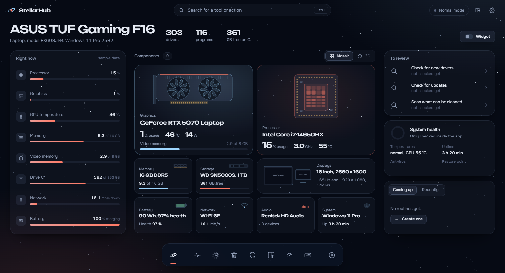
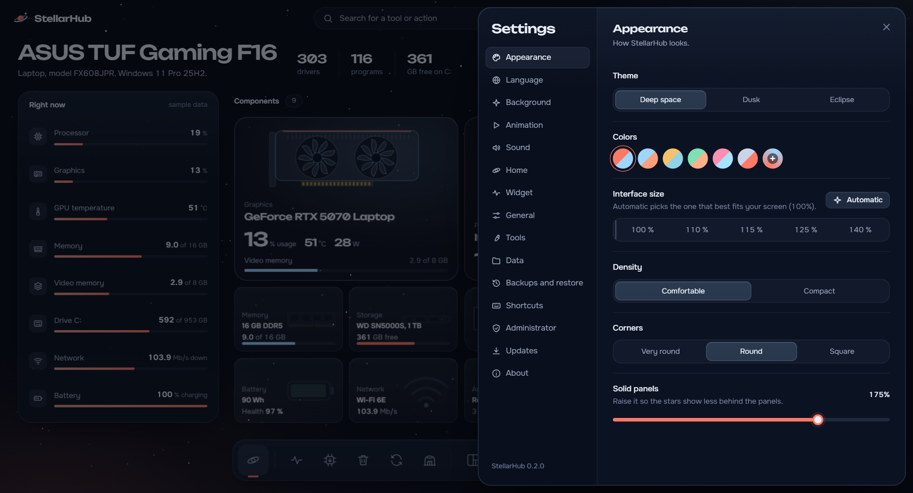

<div align="center">

# 🪐 StellarHub

**The control center for your Windows PC.**
Live hardware stats, drivers, apps, disk space, cleanup and hardware tests, in one carefully crafted app.

[](LICENSE)


[](https://github.com/estebanarosemena/StellarHub/releases/latest)



</div>

## 📑 Contents

- [What it is](#-what-it-is)
- [Modules](#-modules)
- [Also included](#-also-included)
- [Screenshots](#-screenshots)
- [Getting started](#-getting-started)
- [Keyboard shortcuts](#-keyboard-shortcuts)
- [Controller support](#-controller-support)
- [Safety](#-safety)
- [Privacy](#-privacy)
- [Code signing policy](#-code-signing-policy)
- [How it's built](#-how-its-built)
- [Roadmap](#-roadmap)
- [Contributing](#-contributing)
- [License and credits](#-license-and-credits)

## ✨ What it is

StellarHub brings together the tools that are usually spread across half a dozen programs: a system monitor,
a driver and app updater, an uninstaller that removes leftovers, a disk space analyzer, an optimizer and a
peripheral tester.

Everything works with **real data from your PC**, everything that changes the system is **reversible** whenever
possible, and the interface is designed to be a pleasure to use: smooth animations, a configurable starfield and
no cluttered screens.

## 🧩 Modules

### ⌂ Home
Your PC at a glance: the real model, its components as a **tile grid** or a **3D model** you can rotate, live
stats (CPU, GPU, temperatures, memory, disk, network, battery), system health and what needs attention. Each
component opens a detail card with live data; the displays card even shows what is on each monitor right now.

### ∿ Live Monitor
CPU per thread (performance and efficient cores apart), real clock speed, NVIDIA GPU (load, temperature, power,
VRAM), memory, disks with **SMART** health, network and Wi-Fi, battery wear, processes with their icons, and system
health (failing devices and critical events explained in plain language).

### ⇅ Driver Updater
Drivers come from **Windows Update**: signed by Microsoft, the same source as Windows Settings. StellarHub has no driver
database of its own. A full driver inventory, search and install with a restore point first, devices with problems or no
longer connected, **driver backups**, stored versions to roll back to, and history.

### ⌫ Program Remover
Standard, silent or forced uninstall; a **leftover scanner** with a confidence score and the reason for each item;
a **quarantine** so everything can be undone; batch uninstall; **watched installs** (removes exactly what an
installer created); and a hunter mode (point at a window to find out which program it belongs to).

### ↻ Program Updater
App updates through **winget**, Windows Update, Microsoft Store, system components (.NET, Visual C++, WebView2…)
and developer tools (pip, npm), with release notes and a queue that shows real progress.

### ⇪ App Hangar
Pick apps from a curated catalog of 150+ trusted programs (or search all of winget) and install them in one go,
with real progress. Ready-made **kits** (Essentials, Gamer, Developer, Creator…), your own kits, and a short code to
set up another PC the same way.

### ▦ Storage Checker
An interactive map of what each folder takes up, WinDirStat style, with zoom and free space in view. As administrator it reads the NTFS master file table directly, so a full drive scan takes seconds. File types,
largest files, **duplicates**, and comparisons with earlier scans to see what grew.

### ↯ Super Optimizer
Cleanup of temp files and caches, **startup** apps, services, Windows **repairs** (SFC, DISM, chkdsk,
network, Windows Update…) with live output, and performance settings (power plan, visual effects, game mode,
hardware-accelerated GPU scheduling), and **Debloat**: remove preinstalled apps and turn off ads, suggestions,
Widgets, Copilot and Bing in Start search. Everything backed up first and undoable.
A **registry cleaner** exists too, but it is off by default (Microsoft doesn't usually recommend them, and Windows doesn't
need one to stay fast): turn it on in Settings > General > Registry cleaner. It is never part of "Optimize everything".
Its backups stay listed in Settings > Backups and restore either way.

### ⛨ Privacy & Security
A privacy and security score with plain-language findings: which apps used your camera, microphone or location and
when, antivirus, firewall, Secure Boot, TPM, encryption and patch age, open ports and who can reach them, 20 Windows
tracking settings with undo, and an audit of everything that starts on its own (tasks, services, browser extensions).

### ◷ Benchmark Testing
Test every component or run them all for a **StellarHub Score**: processor (per core), graphics (WebGL scenes),
memory bandwidth and latency, CrystalDiskMark-style disk tests, an opt-in network test, and a **stress test** with
live temperatures, clocks and throttling detection. Every run is kept to compare over time.

### ⌨︎ Device Tester
Keyboard (laptop, 100 %, TKL, 75 %, 65 % and several layouts), dead pixels, speakers, microphone, camera and
mouse, with a **CPS test**.

### ◎ Autopilot
Maintenance routines: you choose when (a time, at startup, on unplugging, when space runs low…), under which
conditions and what to do.

## 🎛️ Also included

- **Always-on-top widget**, large (with charts) or small (a slim bar), above everything including the taskbar and on
  every virtual desktop.
- **Tray icon**: a left click opens a panel with live stats, every module and quick actions; a right click shows the
  classic menu. Closing the window keeps StellarHub running in the background.
- **Backups and restore** in Settings: restore points (create, turn on protection, delete) and every backup StellarHub
  made, in one place.
- **Updates itself** from this repository's releases, and installs only files signed by its author (see
  [Updates and security](#-updates-and-security)). Versions with new
  features download in the background and install the next time you open StellarHub; big versions ask you first;
  small fixes wait in *Settings > Updates*. All of it can be turned off there.
- **Command palette** (`Ctrl K`) to jump to any tool or action by typing.
- **Optional administrator mode**, and a permanent one if you want it (no Windows prompt on every launch).
- **Settings for almost everything**: theme, colors, interface size, density, corners, starfield, animation
  intensity and speed, shortcuts to Windows tools and more.
- **Quiet interface sounds**: short, soft sounds for clicks, tabs, dialogs, notifications, scans and updates, never
  more than one per action. Volume and four groups (interface, notifications, tasks, system) in *Settings > Sound*.
- **Follow long work from anywhere**: while a scan, cleanup, update queue or test runs, the module's dock icon wears a
  thin progress ring, Home lists it live, and the taskbar button shows the progress; when it ends elsewhere you get a
  notice with *View* (a Windows notification if StellarHub is in the tray) and a small badge on the icon.
- The **side buttons of your mouse** go back and forward, like in a browser.
- **Lighter effects on battery**: unplugged, StellarHub switches to simpler effects, a calmer starfield and slower
  live data, so it stays smooth and saves power (*Settings > Animation*, on by default). Hidden in the tray it uses
  no GPU at all.
- **Seven languages**: English, Español, Português (Brasil), Italiano, Français, 简体中文 and 日本語. It follows the Windows
  language by default and can be changed in *Settings > General*.

## 🖼️ Screenshots

| Live Monitor | Storage Checker |
|---|---|
|  |  |

| Program Remover | Settings |
|---|---|
|  |  |

> Screenshots were taken with sample data.

## 🚀 Getting started

### ◇ Install it

Download **`StellarHub-Setup-x.y.z.exe`** from the [latest release](https://github.com/estebanarosemena/StellarHub/releases/latest)
and run it. By default it installs **for you only**, in `%LOCALAPPDATA%\Programs\StellarHub`: no administrator
rights and no Windows prompt (the setup also offers *Install for all users*, into `Program Files`, which asks Windows
once). It adds a Start menu shortcut and can be removed from *Settings > Apps* like any other program, and the
installer creates no scheduled task. Silent installs use `/CURRENTUSER` (the default) or `/ALLUSERS`, plus
`/DIR=...`; an existing all-users install is upgraded in place. Requires Windows 10 (1809) or 11, 64-bit; if your PC lacks the
[WebView2 Runtime](https://developer.microsoft.com/microsoft-edge/webview2/), the setup downloads it from Microsoft
(and only runs it if it is signed by Microsoft).

After that, StellarHub keeps itself up to date. A per-user install does it with no prompt at all. An all-users
install asks Windows **once**, the first time, and then makes an on-demand *StellarHub\Update* task (no schedule) so
every later update is silent; uninstalling removes it.

| Version | Example | What happens |
|---|---|---|
| Big | **2**.0.0 | A window shows what's new and you choose when to update |
| New features | 1.**2**.0 | Downloads in the background and installs the next time you open StellarHub (*Settings > Updates > Install new features automatically*) |
| Small fixes | 1.2.**3** | Never interrupts you: it waits in *Settings > Updates* |

Every big and feature version also gets a **name**: a figure of Greek or Roman mythology that is also a star, moon
or constellation, short and easy to say. **2.0.0 is _Atlas_**; small fixes keep the name of their version. It shows in
a corner of every view (`v2.0.0 · ATLAS`) and on the start screen, engraved on the planet.

#### Why an antivirus may flag it

StellarHub is new, not code-signed yet and talks to Windows a lot (drivers, services, startup entries, the
registry), which is exactly what heuristic and machine-learning detections watch. A few engines have flagged it as
"generic" or "suspicious" with no specific malware name. What is done about it:

- the program is built by GitHub Actions from this public repository, with PyInstaller's bootloader **compiled from
  source** (not the prebuilt one shared by thousands of programs), as a folder, without packers;
- it installs **per user** by default (no administrator rights, nothing in `Program Files` or scheduled tasks), and
  reads Windows through WMI inside its own process instead of starting hidden PowerShell windows;
- every release is signed by the author and reported to the antivirus vendors as a false positive.

If yours stops it, you can check the file yourself ([Verifying a download yourself](#verifying-a-download-yourself))
or scan it on [VirusTotal](https://www.virustotal.com).

### ◇ Or take it with you (portable)

Download **`StellarHub-Portable-x.y.z.zip`** from the same release and unzip it anywhere, for example a USB drive.
Run `StellarHub.exe` inside the `StellarHub` folder: no installation. It keeps its settings in a `Data` folder next to
it, adds nothing to Windows' startup or scheduled tasks, and updates itself in place like the installed version.
The PC needs the WebView2 Runtime (Windows 11 and up-to-date Windows 10 already have it). What StellarHub backs up
before changing a PC stays on that PC, so those changes can be undone there.

> The installer is not code-signed yet (see the [code signing policy](#-code-signing-policy)), so Windows
> SmartScreen may say it is from an "unknown publisher". Each release lists the SHA-256 of the setup file and a
> signature of the author, so you can check it is the original (see
> [Verifying a download yourself](#verifying-a-download-yourself)).

### ◇ Run it from source

Needs Python 3.12 or later.

```powershell
git clone https://github.com/estebanarosemena/StellarHub.git
cd StellarHub
python -m pip install -r requirements.txt
pythonw run.py
```

For development, `python run.py --debug` opens the developer tools for the interface.

### ◇ Build the installer

```powershell
powershell -ExecutionPolicy Bypass -File packaging\build.ps1
```

It creates a clean build environment with pinned versions, runs the tests, builds `StellarHub.exe` with
PyInstaller and packs it with [Inno Setup](https://jrsoftware.org/isinfo.php) 6.7+ into `dist\`. The app is built
as a folder (not a single self-extracting file) and without UPX, so it starts as fast as running from source and
does not look like a packed executable to antivirus software. Release builds also **compile PyInstaller's
bootloader from source**: the prebuilt one is byte-for-byte the same in thousands of programs, some of them malware,
and antivirus machine-learning models match on it. The build installs the pinned PyInstaller from its source package
with `PYINSTALLER_COMPILE_BOOTLOADER=1` and fails if `packaging\check_bootloader.py` finds the result identical to the
official wheel's. Locally it compiles it when Visual Studio's C++ tools are found (`STELLARHUB_COMPILE_BOOTLOADER=1`
forces it, `=0` skips it) and otherwise keeps the prebuilt one and says so. `StellarHub.exe` carries a complete version
resource (`packaging\make_assets.py`) and an application manifest (`packaging\StellarHub.manifest`).

Releases are built from this repository by GitHub Actions ([`.github/workflows/build.yml`](.github/workflows/build.yml)),
with the same script.

### ◇ Administrator mode

StellarHub works without it, in limited mode. Installing drivers, cleaning system files, repairing Windows or
reading the CPU temperature and disk SMART data require it; the app suggests it quietly when needed.

Many PCs (especially desktop motherboards) don't report the CPU temperature to Windows at all. In that case
StellarHub reads it from [LibreHardwareMonitor](https://github.com/LibreHardwareMonitor/LibreHardwareMonitor),
[HWiNFO](https://www.hwinfo.com/) (with *Shared Memory Support* on) or [Core Temp](https://www.alcpu.com/CoreTemp/)
if one of them is running, and says which one it used.

## ⌨️ Keyboard shortcuts

| Shortcut | Action |
|---|---|
| `Ctrl K` | Search for a tool or action |
| `Ctrl ,` | Settings |
| `Ctrl 1` … `Ctrl 9` | Go to a module |
| `Alt ←` / `Alt →` or mouse side buttons | Back / forward |
| `Esc` | Close whatever is open, or go back to Home |
| Double-click the top bar | Maximize or restore |
| `Tab` / `Shift Tab` | Move between buttons (dialogs keep the focus inside) |

## 🎮 Controller support

Use StellarHub from the couch or on a handheld: it works with Xbox-style controllers and with handhelds such as the
ROG Ally, and shows PlayStation button names for DualShock and DualSense pads. A focus ring follows you around and
a bar at the bottom lists the buttons that work right now. Plug in or pair a controller and press any button; touch
the mouse or keyboard and the normal interface comes back. With no controller connected it costs nothing.

| Button | Action |
|---|---|
| D-pad / left stick | Move around |
| `A` | Select |
| `B` | Back, or close the dialog |
| `LB` / `RB` | Previous / next tab |
| `LT` / `RT` | Previous / next module |
| `Y` | Search (command palette) |
| `Menu` | Settings |
| `View` | Home |
| Right stick | Scroll |

It can be turned off in *Settings > General*. To check a controller (buttons, triggers, sticks, drift, rumble) open
*Device Tester > Controller*.

## 🛡️ Safety

StellarHub touches sensitive parts of Windows, so it does it carefully:

- Everything that changes the system **asks for confirmation** first.
- Before important changes it creates a **restore point**, saves a **backup** (registry, services, startup) or
  moves deleted items to a **quarantine** they can be restored from.
- Some areas are **never touched**: Windows itself, shared folders, personal data, critical services, kernel
  drivers and StellarHub's own folder.
- Whatever Windows does not report is shown as "—": the app never makes up numbers.

## 🔒 Privacy

StellarHub has no account, no telemetry and no analytics: it never sends anything about you or your PC anywhere.
The few times it goes online (to check for its own updates, to download app icons, or for a network test you
start) are listed in [PRIVACY.md](PRIVACY.md), with how to turn each one off.

## 🔐 Updates and security

Every file of a release (`StellarHub-Setup-x.y.z.exe`, `StellarHub-Portable-x.y.z.zip`) comes with a detached
signature (`.sig`) made by the author on his own PC with an Ed25519 key that never leaves it. StellarHub 2.0.0 and
later carry the matching public key inside the program and install an update only if:

1. the release has a `.sig` for that file,
2. the signature covers the file's name, its version and the SHA-256 of the exact bytes StellarHub downloaded, and
3. it was made by a key StellarHub trusts.

So a stolen GitHub account is not enough to push a malicious update: whoever has it can upload files, but cannot
sign them. A release without a valid signature is never installed by StellarHub; it only offers to open the release
page. The published `.sha256` files are for people; the signature is what the app relies on. The key list lives in
`stellarhub/engine/selfupdate.py` and can be rotated by a release signed with the old key. The verification code is
plain Python (`stellarhub/ed25519.py`, tested against all the RFC 8032 test vectors), with no extra dependencies.

### Verifying a download yourself

Download the file and its `.sig` from the release, then, with Python 3.12+ and this repository:

```powershell
python tools/release_sign.py verify StellarHub-Setup-2.1.0.exe StellarHub-Setup-2.1.0.exe.sig --version 2.1.0
```

It prints `OK` only if the file is exactly what the author signed for that version. (`--pubkey <hex>` checks against
a key you got elsewhere instead of the one in the code.)

## 🔏 Code signing policy

StellarHub is applying to the [SignPath Foundation](https://signpath.org) for free code signing for open-source
projects. Once accepted, releases will say: *Free code signing provided by [SignPath.io](https://about.signpath.io),
certificate by [SignPath Foundation](https://signpath.org)*.

- **What gets signed:** only the installer and program built by GitHub Actions from this repository
  ([`.github/workflows/build.yml`](.github/workflows/build.yml)), never a file built on a personal computer.
- **Committers and reviewers:** [estebanarosemena](https://github.com/estebanarosemena)
- **Approvers** (every release is approved by hand before it is signed): [estebanarosemena](https://github.com/estebanarosemena)
- **Privacy:** see [PRIVACY.md](PRIVACY.md). This program will not transfer any information to other networked
  systems unless specifically requested by the user or the person installing or operating it.

## 🏗️ How it's built

- **Python** for everything that talks to Windows (`stellarhub/engine/`): live telemetry (psutil, performance
  counters, nvidia-smi), WMI (in-process, through .NET), PowerShell only for what you ask for, Windows Update,
  winget, pnputil…
- **A single interface** in plain HTML, CSS and JavaScript, no frameworks (`stellarhub/ui/`), inside a native
  window powered by [pywebview](https://pywebview.flowrl.com/) and WebView2.
- How a module is written and how it talks to the engine: [`docs/UI_CONTRACT.md`](docs/UI_CONTRACT.md).

```
run.py                     launcher
stellarhub/
├─ app.py                  entry point: main() wires the pieces below together
├─ config.py               constants, folders and the mode this copy runs in (installed, portable, test)
├─ settings.py             settings.json: read, write, reset, the installer's --setup, file migrations
├─ startup.py              everything before the window: command-line modes, start screen, staged update
├─ instance.py             single-instance lock, handoff to / takeover from another copy
├─ elevation.py            administrator mode: the scheduled task and the elevated relaunch
├─ autostart.py            "open with Windows" entry
├─ log.py                  the [phase] start timeline, the log file, the last-resort error box
├─ winmgr.py               window mechanics: DPI, tray-panel placement, corners, WebView2 visibility
├─ api/                    what the interface can call (pywebview js_api), one mixin per area
├─ chrome.py               custom window frame (move, resize, maximize)
├─ tray.py                 tray icon
├─ engine/                 engine: one file per module, plus telemetry, system info and long-running jobs
│  └─ removal/             leftover scanner, quarantine, cleanup and Windows startup
└─ ui/                     interface: core, shell, modules, Home views and widget
packaging/                 build script, PyInstaller recipe, Inno Setup installer and the portable .zip
tests/                     engine tests (they never touch the system)
docs/                      UI contract and screenshots
designs/                   the early design explorations
```

**Tests:** `python -m unittest discover -s tests -t .`

## 🗺️ Roadmap

- [x] Full interface for all 12 modules
- [x] Real engine: telemetry, drivers, apps, updates, disk, optimizer and monitor
- [x] Autopilot running routines on its own (while StellarHub is open, also hidden in the tray)
- [x] `.exe` installer
- [x] Seven languages
- [x] Automatic StellarHub updates from this repository
- [x] Portable version (1.0.0)
- [x] Updates signed by the author, verified before installing (2.0.0)
- [x] Controller navigation and a controller tester (2.0.0)
- [x] Desktop-tower 3D view, lighter mode for battery and integrated graphics (2.0.0)
- [x] Long work followed from anywhere: dock rings, Home, taskbar progress and completion notices (2.0.0)
- [ ] Code-signed releases (SignPath Foundation)

## 🤝 Contributing

Ideas, bug reports and improvements are welcome: open an issue or a pull request. If you add or change a module,
start with [`docs/UI_CONTRACT.md`](docs/UI_CONTRACT.md), and only test anything that touches the system in
read-only mode.

Translations live in [`stellarhub/ui/i18n/`](stellarhub/ui/i18n/): one JSON file per language and area, with the
rules and glossary in its README. Corrections from native speakers are especially welcome.

## 📜 License and credits

Created by **Esteban Arosemena** and **Claude**.

StellarHub is free software: you can redistribute it and/or modify it under the terms of the
**GNU General Public License v3.0**. See [LICENSE](LICENSE).

Built with [pywebview](https://github.com/r0x0r/pywebview) (BSD-3), [psutil](https://github.com/giampaolo/psutil)
(BSD-3), [pystray](https://github.com/moses-palmer/pystray) (LGPLv3), [Pillow](https://python-pillow.org/)
(MIT-CMU), [three.js](https://threejs.org/) (MIT) and the [Unbounded](https://github.com/googlefonts/unbounded)
and [Onest](https://github.com/simpals/onest) fonts (SIL Open Font License 1.1).

Sounds: **Orbital**, an original set made for StellarHub (CC0), except the hover sound,
["UI hover"](https://freesound.org/people/unfa/sounds/565131/) by unfa on Freesound (CC0). The list is in
[`stellarhub/ui/sounds/CREDITS.json`](stellarhub/ui/sounds/CREDITS.json).
