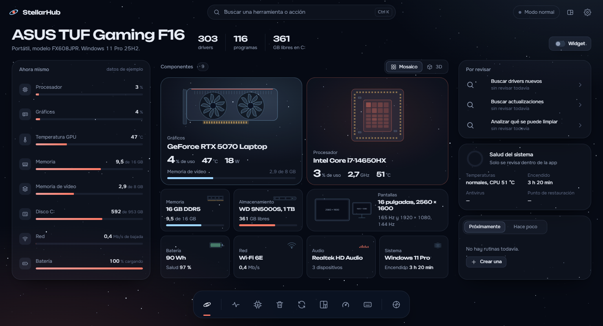
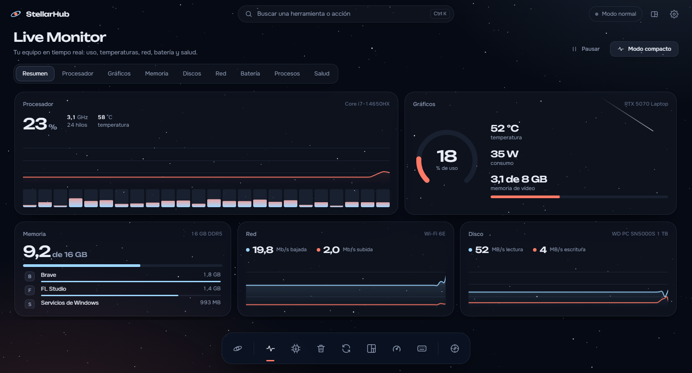

<div align="center">

# 🪐 StellarHub

**El centro de control de tu PC con Windows.**
Tu equipo en vivo, drivers, programas, disco, limpieza y pruebas de hardware, en una sola app cuidada al detalle.

[](LICENSE)




</div>

## Índice

- [✨ Qué es](#-qué-es)
- [🧩 Módulos](#-módulos)
- [🎛️ Además](#️-además)
- [🖼️ Capturas](#️-capturas)
- [🚀 Instalación](#-instalación)
- [⌨️ Atajos](#️-atajos)
- [🛡️ Seguridad](#️-seguridad)
- [🏗️ Cómo está hecho](#️-cómo-está-hecho)
- [🗺️ Hoja de ruta](#️-hoja-de-ruta)
- [🤝 Contribuir](#-contribuir)
- [📜 Licencia y créditos](#-licencia-y-créditos)

## ✨ Qué es

StellarHub reúne en un solo sitio las herramientas que normalmente están repartidas en media docena de programas:
un monitor del sistema, un actualizador de drivers y de programas, un desinstalador que borra los restos, un
analizador de espacio, un optimizador y un probador de periféricos.

Todo trabaja con **datos reales de tu equipo**, todo lo que cambia el sistema es **reversible** cuando se puede, y
la interfaz está pensada para que usarla sea agradable: animaciones fluidas, un fondo espacial configurable y
ninguna pantalla recargada.

## 🧩 Módulos

### 🏠 Inicio
Tu equipo de un vistazo: el modelo real, sus componentes en un **mosaico** o en un **modelo 3D** que puedes girar,
el estado en vivo (CPU, GPU, temperaturas, memoria, disco, red, batería), la salud del sistema y lo que hay
pendiente. Cada componente abre una ficha con datos en vivo; la de pantallas muestra en directo lo que se ve en
cada monitor.

### 📈 Live Monitor
CPU por hilo (separando núcleos de rendimiento y eficientes), frecuencia real, GPU NVIDIA (uso, temperatura, consumo,
VRAM), memoria, discos con salud **SMART**, red y Wi-Fi, batería con su desgaste, procesos con su icono y la salud
del sistema (dispositivos con error y eventos críticos explicados en lenguaje claro).

### 🔧 Driver Updater
Inventario de todos los drivers, búsqueda e instalación desde **Windows Update** con punto de restauración,
dispositivos con problemas o desconectados, **copias de seguridad** de los drivers, versiones guardadas para
revertir e historial.

### 🗑️ Program Remover
Desinstalación normal, silenciosa o forzada; **escáner de restos** con nivel de confianza y motivo; **cuarentena**
para deshacer; desinstalación por lotes; **instalación vigilada** (quita exactamente lo que creó un instalador) y
modo cazador (apuntas a una ventana y te dice qué programa es).

### 🔄 Program Updater
Actualizaciones de programas con **winget**, Windows Update, Microsoft Store, componentes del sistema (.NET,
Visual C++, WebView2…) y herramientas de desarrollo (pip, npm), con notas de versión y una cola con progreso real.

### 💾 Storage Checker
Mapa interactivo de lo que ocupa cada carpeta, al estilo WinDirStat, con zoom y el espacio libre a la vista. Tipos
de archivo, archivos más grandes, **duplicados** y comparación con análisis anteriores para ver qué creció.

### ⚡ Super Optimizer
Limpieza de temporales y cachés, programas de **arranque**, servicios, registro, **reparaciones** de Windows (SFC,
DISM, chkdsk, red, Windows Update…) con la salida en vivo, y ajustes de rendimiento (plan de energía, efectos
visuales, modo juego, GPU por hardware). Todo con copia previa y deshacer.

### ⌨️ Device Tester
Teclado (portátil, 100 %, TKL, 75 %, 65 % y varios idiomas), píxeles muertos, altavoces, micrófono, cámara y
ratón, con **test de CPS**.

### 🤖 Autopilot
Rutinas de mantenimiento: eliges cuándo (hora, al iniciar, al desenchufar, con poco espacio…), con qué
condiciones y qué hacer.

## 🎛️ Además

- 🪟 **Widget siempre visible**, en versión grande (con gráficas) o pequeña (una barra fina), por encima de todo,
  incluida la barra de tareas y en todos los escritorios virtuales.
- 📌 **Icono en la bandeja** con accesos rápidos; cerrar la ventana la deja en segundo plano.
- 🔍 **Paleta de comandos** (`Ctrl K`) para ir a cualquier herramienta o acción escribiendo.
- 🛡️ **Modo administrador** opcional, y permanente si lo quieres (sin el aviso de Windows en cada arranque).
- 🎨 **Ajustes para casi todo**: tema, colores, tamaño de la interfaz, densidad, esquinas, fondo de estrellas,
  intensidad y velocidad de las animaciones, accesos directos a las herramientas de Windows y más.
- 🖱️ Los **botones laterales del ratón** van atrás y adelante, como en el navegador.

## 🖼️ Capturas

| Live Monitor | Storage Checker |
|---|---|
|  |  |

| Program Remover | |
|---|---|
|  | |

> Las capturas se hicieron con datos de ejemplo.

## 🚀 Instalación

> Pronto habrá un instalador `.exe`. Mientras tanto, se ejecuta desde el código.

**Requisitos**

- Windows 10 u 11 (64 bits)
- Python 3.12 o superior
- [WebView2 Runtime](https://developer.microsoft.com/microsoft-edge/webview2/) (Windows 11 ya lo trae)

**Pasos**

```powershell
git clone https://github.com/Chivitos100/StellarHub.git
cd StellarHub
python -m pip install -r requirements.txt
pythonw run.py
```

Para desarrollar: `python run.py --debug` abre las herramientas de desarrollo de la interfaz.

**¿Modo administrador?** StellarHub funciona sin él, en modo limitado. Instalar drivers, limpiar archivos del
sistema, reparar Windows o leer la temperatura de la CPU y el SMART de los discos lo necesitan; la app lo sugiere
con discreción cuando hace falta.

## ⌨️ Atajos

| Atajo | Acción |
|---|---|
| `Ctrl K` | Buscar una herramienta o acción |
| `Ctrl ,` | Ajustes |
| `Ctrl 1` … `Ctrl 9` | Ir a un módulo |
| `Alt ←` / `Alt →` o botones laterales del ratón | Atrás / adelante |
| `Esc` | Cerrar lo que esté abierto o volver a Inicio |
| Doble clic en la barra superior | Maximizar o restaurar |

## 🛡️ Seguridad

StellarHub toca partes delicadas de Windows, así que lo hace con cuidado:

- Todo lo que modifica el sistema **pide confirmación**.
- Antes de los cambios importantes crea un **punto de restauración**, guarda una **copia** (registro, servicios,
  arranque) o mueve lo eliminado a una **cuarentena** desde la que se puede restaurar.
- Hay zonas que **nunca se tocan**: Windows, carpetas compartidas, datos personales, servicios críticos, drivers
  del núcleo y la propia carpeta de StellarHub.
- Lo que Windows no informa se muestra como «—»: la app no se inventa números.

## 🏗️ Cómo está hecho

- 🐍 **Python** para todo lo que toca Windows (`stellarhub/engine/`): telemetría en vivo (psutil, contadores de
  rendimiento, nvidia-smi), WMI, PowerShell, Windows Update, winget, pnputil…
- 🌐 **Una sola interfaz** en HTML, CSS y JavaScript sin frameworks (`stellarhub/ui/`), dentro de una ventana
  nativa con [pywebview](https://pywebview.flowrl.com/) y WebView2.
- 📄 Cómo se escribe un módulo y cómo habla con el motor: [`docs/CONTRATO_UI.md`](docs/CONTRATO_UI.md).

```
run.py                     lanzador
stellarhub/
├─ app.py                  ventana, API para la interfaz, widget y modo administrador
├─ chrome.py               marco propio de la ventana (mover, redimensionar, maximizar)
├─ tray.py                 icono de la bandeja
├─ engine/                 motor: un archivo por módulo + telemetría, sistema y tareas largas
│  └─ removal/             escáner de restos, cuarentena, limpieza e inicio de Windows
└─ ui/                     interfaz: núcleo, armazón, módulos, vistas de Inicio y widget
tests/                     pruebas del motor (no tocan el sistema)
docs/                      contrato de la interfaz y capturas
```

**Pruebas:** `python -m unittest discover -s tests -t .`

## 🗺️ Hoja de ruta

- [x] Interfaz completa de los 9 módulos
- [x] Motor real: telemetría, drivers, programas, actualizaciones, disco, optimizador y monitor
- [ ] Autopilot ejecutando las rutinas por su cuenta
- [ ] Instalador `.exe`
- [ ] Actualizaciones automáticas de StellarHub desde este repositorio
- [ ] Interfaz en inglés

## 🤝 Contribuir

Las ideas, los avisos de fallos y las mejoras son bienvenidos: abre un *issue* o un *pull request*. Si vas a
añadir o cambiar un módulo, empieza por [`docs/CONTRATO_UI.md`](docs/CONTRATO_UI.md) y prueba lo que toque el
sistema solo en modo lectura.

## 📜 Licencia y créditos

Creado por **Esteban Arosemena** y **Claude**.

StellarHub es software libre: puedes redistribuirlo y modificarlo bajo los términos de la
**GNU General Public License v3.0**. Consulta [LICENSE](LICENSE).

Usa [pywebview](https://github.com/r0x0r/pywebview) (BSD-3), [psutil](https://github.com/giampaolo/psutil)
(BSD-3), [pystray](https://github.com/moses-palmer/pystray) (LGPLv3), [Pillow](https://python-pillow.org/) (MIT-CMU),
[three.js](https://threejs.org/) (MIT) y las fuentes [Unbounded](https://github.com/googlefonts/unbounded) y
[Onest](https://github.com/simpals/onest) (SIL Open Font License 1.1).
